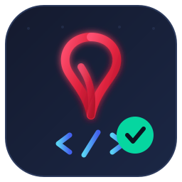

<div align="center">



# 🎗️ aids0-autoquiz

**全国大学生预防艾滋病知识竞赛 · 自动答题工具**

纯 Python · 微信登录态提取 · 官方 100 题题库 · 逆向答题接口

[](https://www.python.org/)
[]()
[](LICENSE)
[]()

**简体中文** · [English](README.md)

*本项目用于安全研究与自动化技术学习，请仅对你本人有权限的账号使用。*

</div>

---

## 📖 项目简介

`aids0-autoquiz` 自动完成 **aids0.com**（2026 年第十一届全国大学生预防艾滋病知识竞赛）
的完整答题流程——从微信登录态提取，到逐题提交、自动评分。

它是在**逆向站点真实请求链**之后实现的。该站采用**逐题、有状态提交**的答题接口；
逆向过程中我们也验证了：**“免答题直接提交”在设计上不可行**（服务端一题一提交、
每提交一次轮换防重放令牌），因此唯一可行的自动化方式是**逐题真实作答**。

> **实测战绩：** 完整跑一轮得 **92 / 100 分**（合格线 60），并与站点自带错题集页面交叉核对一致。

---

## ✨ 特性

| | |
|---|---|
| 🍪 **微信 Cookie 提取** | 纯 Python：卷影副本(VSS) → DPAPI → AES-256-GCM。无需外部脚本、无需抓包。 |
| 🧠 **三级作答引擎** | 本地 100 题题库 → LLM 兜底 → 启发式。 |
| 🎯 **选项乱序安全匹配** | 答案以“选项文本”存储，自动对齐到试卷实际选项顺序。 |
| 🔁 **完整流水线** | 登录态 → 报名 → 开始答题 → 逐题提交 → 自动评分。 |
| 📇 **官方题库** | 结构化 100 题（单选 / 多选 / 判断）。 |
| 🪟 **Windows 原生** | 读取本机微信 4.x 内置浏览器 Cookie 库。 |

---

## 🔬 工作原理

### 1. 登录态提取

竞赛登录使用微信 OAuth（`snsapi_base` 静默授权），服务端下发 session cookie（`PHPSESSID`）。
该 Cookie 存放在**微信 4.x 内置浏览器（Chromium）**的 Cookie 库中：

```
%APPDATA%\Tencent\xwechat\radium\web\profiles\*\Network\Cookies
```

该库被微信独占锁定，`encrypted_value` 为 Chromium-OSCrypt 加密。`wx_cookie.py` 用纯 Python 还原：

```
Win32_ShadowCopy (WMI)  ──►  通过卷影路径复制被锁定的 Cookies 库
Local State -> os_crypt.encrypted_key (base64, 'DPAPI' 前缀)
DPAPI (ctypes CryptUnprotectData)  ──►  AES-256 主密钥
AES-256-GCM  ──►  逐条解密 cookie  ──►  剥离微信二进制头  ──►  PHPSESSID
```

> 需要管理员权限（VSS）+ 同一 Windows 用户（DPAPI 绑定当前用户）。

### 2. 答题接口（逆向结果）

| 阶段 | 请求 |
|------|------|
| 登录 | `mblogin.php` → 微信授权（`redirect_uri=mblogin2.php`） |
| 报名 | `POST answer2.html` — `year/school/fullname/qq/mobile/studentid/gmajor/sex/subinfo` |
| 关注门槛 | `acertpre.php → acertpre1.php?code=` |
| 开始答题 | `POST preanswer1.html?vip=X` — `getq=开始答题`（消耗 1 次机会，抽 25 题） |
| 取题 | `GET answer2.html?vip=Y` — 一页一题 |
| 提交一题 | `POST answer2.html?vip=Y` — 判断 `rightorwrong=1/0`、单选 `ifright1=N`、多选 `ifright1..n=1`，均带 `questionid` 与 `answer=提交` |
| 成绩 / 错题 | 成绩页 / `review-<id>.html` |

> ⚠️ **“免答题直接提交”不可行**：每次提交都轮换 `vip` 令牌（防重放），服务端维护逐题状态机。

---

## 🚀 快速开始

```bash
pip install -r requirements.txt

# 1) 在【电脑版微信】里登录竞赛站：打开 http://www.aids0.com/mblogin.php ，完成授权
# 2) 提取微信登录 Cookie（弹 UAC 请点"是"）
python wx_cookie.py fresh

# 3) 全自动：报名(如需) -> 答题 -> 交卷 -> 评分
python -m app.auto_live --identity place
```

生成可扫码的登录二维码（并自动复制链接到剪贴板）：

```bash
python -m app.auto_live --qrcode
```

---

## 🗂️ 项目结构

```
wx_cookie.py              ★ 纯 Python 微信 Cookie 提取（VSS + DPAPI + AES-GCM）
app/
  auto_live.py            ★ 一键流水线 + 二维码
  live_engine.py          答题页 DOM 解析（题型 / 题干 / 选项 / questionid）
  run_quiz.py             逐题决策引擎（题库 -> LLM -> 启发式）
  bank.py                 题库 + 选项文本对齐匹配
  parser.py, solver.py, submit.py, http_client.py, config.py
data/
  question_bank.json      官方 100 题（38 单选 / 31 多选 / 31 判断）
  official_bank_raw.txt   原始题库文本
tools/
  parse_official_bank.py  从原始文本重建 question_bank.json
samples/
  sample_quiz.html        离线演示样例
```

---

## ⚙️ 配置

复制 `config.example.json` → `config.json`，关键字段：

| 字段 | 含义 |
|------|------|
| `login.cookie` | 会话 Cookie（由 `wx_cookie.py` 自动填充） |
| `answer.bank_match_threshold` | 题干匹配相似度阈值（默认 `0.62`） |
| `llm.enabled / api_key / model` | 可选 LLM 兜底（OpenAI 兼容接口） |
| `safety.dry_run` | 只解析、不提交 |

---

## 🧩 已知限制

- **仅 Windows** 支持 Cookie 提取（微信 4.x 内置浏览器 + VSS + DPAPI）。
- **必须真实微信授权** —— 没有 session 就无法答题。Cookie 必须来自本机已登录的微信。
- **每账号答题次数有限**（初始 1 次，邀请最多 3 次，取最高分）。
- **跨设备**：手机扫码不会把会话转移到电脑——Cookie 留在扫码的那台设备上。

---

## ⚖️ 免责声明

本项目仅用于**安全研究、逆向工程学习、以及你本人有权使用的账号上的个人自动化**。
请遵守平台服务条款。作者不对任何滥用行为负责。

---

## 📄 许可证

[MIT](LICENSE)
